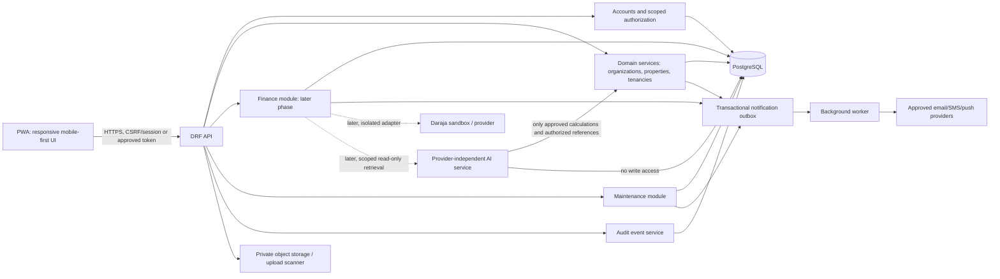

# Technical Product Specification: Kenyan Property Management Platform

**Status:** Draft for product, engineering, security and professional review  
**Scope of this deliverable:** Product and technical specification only. No application code, migrations, deployment configuration, or tests have been implemented.

## 1. Purpose and product boundary

The platform supports landlords, property managers, tenants and caretakers in managing property records, units, tenancies, rent obligations and payment records, maintenance, and communication. It is a responsive, mobile-first Progressive Web App (PWA), backed by Django, Django REST Framework (DRF), and PostgreSQL. Monetary values are denominated in Kenyan shillings (KES); application timestamps use `Africa/Nairobi` for display and UTC-aware timestamps for storage and interchange.

The system of record is the application database. Payment provider callbacks, uploaded documents, user-submitted text, and AI output are inputs that must be validated; none independently override trusted records. Rent accounting and AI are sequenced after the authorization foundation. Daraja integration is later still and must be sandbox-tested before any production payment enablement.

### Confirmed requirements

- The user groups are landlords, property managers, tenants and caretakers.
- Django/DRF, PostgreSQL, a responsive mobile-first PWA, KES and `Africa/Nairobi` are specified defaults.
- The platform needs properties, units, tenancy records, rent schedules, payment records, maintenance requests, communication history, auditability, privacy controls and access control.
- Authentication, explicit roles and object-level authorization are prerequisites to domain features.
- Historical tenancy and financial records must not be silently overwritten or deleted. Corrections must be authorized and traceable.
- AI must be provider-independent, access controlled, evidence-referencing, non-mutating for financial/tenancy data, and subject to human approval before sending drafted communications.
- Daraja integration must be server-side, idempotent, reconcilable, and kept out of real-money use until explicitly approved.

### Assumptions to validate

- A landlord owns one or more organizations or portfolios; a property belongs to one organization. A landlord may invite managers and caretakers into an organization.
- A user account may participate in multiple organizations and may have different roles in each. A person may also be a tenant in one or more organizations.
- A unit has at most one active tenancy at a time. A future tenancy may be recorded if its dates do not overlap another active or scheduled tenancy under the accepted date policy.
- Tenants are invited by email or phone using a one-time, expiring token, then authenticate and explicitly accept the invitation for themselves.
- The first release supports one primary currency (KES) and one operating time zone (`Africa/Nairobi`).
- Manual payment records are internal records of what an authorized user reports or observes. They are not provider confirmations.

### Open decisions

Resolve these before the relevant implementation phase; do not silently choose legal or commercial policy.

1. Is the customer/account boundary an individual landlord, a legal entity, or a portfolio organization? Can an account join multiple organizations?
2. Which identity/contact channels are required for login and invitations (email, phone, or both)? Which SMS/email vendors and delivery regions are approved?
3. Are roles fixed, or can organization administrators define limited custom roles? Who can invite/remove organization members?
4. What are the exact rent due-date conventions, grace periods, partial-period proration, leap-day handling and schedule generation horizon?
5. How are deposits held, reconciled, refunded, forfeited or transferred? Are deposit transactions in scope for the first finance release?
6. Which manual payment methods and reference uniqueness scopes are required? Can identical references legitimately occur across methods, properties, or providers?
7. What correction and approval thresholds apply to payment reversals, rent adjustments and allocation changes?
8. Should overpayments remain as tenant credit, be refunded, or be carried forward by explicit authorization? Who can authorize each action?
9. What invitation expiry, resend, cancellation and duplicate rules are desired? Can a tenant reject or request correction of terms?
10. What files can be attached, maximum size, retention period, malware scanning service and permitted formats?
11. Which communication channels and retention periods apply? Are message delivery/read receipts needed?
12. What hosting region, recovery point objective (RPO), recovery time objective (RTO), availability target and monitoring stack are required?
13. What privacy notices, lawful bases, data-subject request procedures, retention schedules, and breach-response timelines have counsel approved for the operating model?
14. Which legal professional will review tenancy agreement templates, notices, deposit handling, arrears wording, termination workflow, electronic records/signatures and applicable Kenyan privacy obligations?
15. Which official Daraja product(s), callback verification mechanism, sandbox credentials process, settlement/reconciliation model and launch approvals will apply?
16. Which AI provider(s), hosting/data-processing terms, data residency, retention controls, and redaction policy are acceptable?

## 2. Roles and permission boundaries

Authorization is enforced server-side on every request and every referenced object. The server derives the organization/property/tenant scope from authenticated membership and relationships; it never trusts a submitted landlord, tenant, property, unit, organization, recorder, role, or payment-status identifier as authority. Use deny-by-default permission checks and queryset scoping, with a second object-level check for mutations.

| Role | Permitted scope (proposed) | Explicit boundaries |
|---|---|---|
| Landlord / organization owner | Manage organization profile, properties, units, memberships, assigned managers, tenancies, invitations, rent policy, financial records, maintenance, exports and audit views within owned organization(s). | No access to another organization. Sensitive financial corrections should require reason and may require second approver (threshold TBD). |
| Property manager | Manage explicitly assigned properties: units, invitations, tenancy administration, rent schedules, manual payment records/allocations if granted, maintenance assignments and tenant communication. | No organization ownership/member administration unless separately granted. No unassigned property or cross-organization access. Cannot silently erase or rewrite history. |
| Caretaker | View assigned property/unit operational details needed for duties; receive and update assigned maintenance work; communicate about those tickets. | No rent/payment/deposit details by default; no tenancy terms beyond minimum operational context; no access to unrelated units/tenants. Cannot reassign outside allowed scope. |
| Tenant | View own accepted/pending invitation and tenancy terms; view own rent obligations, payment/receipt/arrears records when finance phase is released; submit and view own maintenance requests; view relevant communications and request corrections. | Cannot enumerate other tenants/units, alter tenancy terms or payment facts, accept for another person, or see management-only notes. |
| Platform operator/support | Narrow, time-bound operational access for support with audited reason and elevated approval where appropriate. | Not a routine domain role; no broad access by default, no use of customer records for unrelated purposes. |
| Service identity | Specific background tasks only, such as notification dispatch or schedule generation. | No interactive login; least-privilege credentials, scoped database grants, recorded job identity, idempotent processing. |

Role membership is organization-scoped and may be property-scoped for managers/caretakers. Tenant access is established by an accepted invitation and active/historical tenancy relationship, not by a client-supplied tenant ID. Revoking a membership or session must take effect promptly, including in background jobs and cached permission data.

## 3. Lifecycle and workflows

### 3.1 Property, building and unit lifecycle

Proposed hierarchy: **Organization → Property → Building (optional grouping) → Unit**. Building is a grouping record; a property can have buildings or direct units. Address and location fields are structured where practical, with private contact/location data minimized. Records are archived/retired rather than deleted once referenced by a tenancy, financial record, ticket or audit event.

Property states: `draft`, `active`, `archived`. Unit states: `draft`, `available`, `reserved`, `occupied`, `maintenance`, `inactive`. Unit state is a convenience projection; tenancy state and dates are authoritative. Transition rules are server-enforced and audited. Archiving a property blocks new activity but preserves historical read access according to authorization and retention policy.

### 3.2 Tenancy and tenant invitation lifecycle

Proposed states: `draft`, `invited`, `accepted_pending_start`, `active`, `scheduled_to_end`, `ended`, `cancelled`, `declined`, `expired`. Define exact transitions and date-driven transitions in implementation; state changes must be idempotent and audited.

1. An authorized manager creates an invitation for a specific unit, intended tenant contact, proposed start/end, agreed rent, due-day rule, deposit terms/reference and agreement reference. The server validates access to the unit and date/rent fields.
2. The system sends an opaque, single-use token through an approved channel. Store only a cryptographic hash of the token; expire it after a configurable policy period. Resends rotate/revoke prior tokens. Duplicate pending invitations for the same unit/contact are rejected or explicitly replaced with an audit event (policy decision).
3. The invitee authenticates and reviews the complete proposed terms. They accept or decline only as the authenticated invitee. A manager may cancel or correct by issuing a new invitation, but cannot impersonate tenant acceptance. Any alternative representation needs an explicitly approved authorization mechanism and evidence trail.
4. Acceptance records actor, timestamp, terms version and evidence of the acceptance action. If terms change after acceptance, require a new version and explicit acceptance rather than mutating accepted terms in place.
5. Starting, ending, cancellation and extension preserve prior versions. End dates are interpreted using one documented convention (recommended half-open interval `[start, end)` to avoid boundary ambiguity; approval required). Validate start before end and prevent overlapping active/scheduled intervals for a unit. The database must enforce overlap safety under concurrency (e.g. PostgreSQL exclusion constraint over a range, or serialized transactional locking plus a database constraint where feasible).
6. Tenancy termination records effective date, initiator, reason category, notes, outstanding operational tasks and agreement/reference evidence. It does not infer legal notice validity, eviction authority, deposit disposition or other legal outcome. Professional review is required for notices and statutory procedures.

### 3.3 Rent schedules, payment records and allocations

**Financial invariants (must be approved before finance implementation):**

- Use integer minor currency units (KES cents) or PostgreSQL `NUMERIC` with fixed scale; never binary floating point. Store currency with each monetary record even if only KES is enabled.
- An obligation is generated from an immutable/versioned accepted tenancy rent schedule and a deterministic period key. A uniqueness constraint on tenancy + schedule version/period prevents duplicate generation on retry.
- A payment record is immutable after confirmation of entry. Corrections are append-only reversal/correction records with reason, actor, timestamp, and reference to the original; a record is never silently deleted or overwritten.
- An allocation amount is positive and cannot exceed the remaining allocatable payment amount or remaining obligation balance, unless a separately approved adjustment model explicitly accounts for a credit. Enforce in a transaction with row locking and database constraints where possible.
- Total active allocations for a payment cannot exceed payment amount. Total allocations to an obligation cannot exceed obligation amount unless the excess is explicitly represented as tenant credit/unallocated balance.
- Arrears are a derived view: due obligations less valid allocations and approved credits/adjustments as of a specified date. Do not store a manually editable arrears balance as truth. State calculation policy for not-yet-due obligations, grace periods and timezone date boundaries.
- A payment may be partially allocated. Remaining balance is unallocated; it may be allocated later by an authorized user. Overpayment remains unallocated tenant credit until explicit allocation or refund workflow is approved; never auto-apply across tenants or tenancies.
- Payment references are unique only within an approved scope (for example provider + provider transaction ID, or payment method + reference + organization); define normalization and nullable-reference behavior before constraining.
- Manual records are clearly labeled **Manual record — not provider-confirmed**. A receipt documents the application record and is not proof of settlement. Uploaded screenshots are supporting attachments only, never independent confirmation.
- Provider confirmation, manual recording, allocation, correction and reconciliation are separate events/states. Browser redirects do not confirm a provider payment.
- Rent adjustments are append-only, authorized entries linked to obligation/tenancy and include reason, effective period, amount/direction, approver as required, and supporting reference. Define whether adjustments revise an obligation via reversal/replacement or a separate credit/debit line; do not edit generated obligation amounts in place.
- Disputes flag a payment or obligation and record claimant, timestamp, reason, evidence references and resolution events. A dispute does not silently erase the record or automatically alter confirmed provider status.

**Partial-period rent, due date, arrears grace, deposit accounting and overpayment refund policy are open decisions.** Do not encode legal or contractual assumptions in code until product and professional review approve them.

### 3.4 Maintenance workflow

Tenant submits a ticket for their own unit with description, category, priority, optional attachment and preferred contact details. Server verifies the tenancy/unit relationship and limits file types/size; scan attachments before making them available. Manager/caretaker assigns ticket only to an authorized member. Proposed states: `submitted`, `triaged`, `assigned`, `in_progress`, `waiting_on_tenant`, `resolved`, `closed`, `reopened`, `cancelled`.

Every state transition, assignment, comment visibility change and closure records actor and timestamp. Closure requires a closure note; tenant-facing and internal notes are explicitly distinct. Tenants see their tickets, tenant-visible updates and closure outcomes, never internal notes or unrelated tickets. Repeated submissions are not silently merged; a duplicate candidate may be suggested to staff, with both records retained. Reopening creates a new event and preserves closure history.

### 3.5 Notifications and communication history

An outbox pattern records notification intent in the same database transaction as the domain event; a worker sends asynchronously with retries and idempotency keys. Track channel, template/version, recipient reference, dispatch attempts, provider message ID, delivery state when available, and failure reason with sensitive payload minimization. Never put invitation bearer tokens or full financial/personal details in logs. User-visible communication history distinguishes system notifications, user-authored messages and delivery status. Define consent, channel preferences, quiet hours and retention before launch.

## 4. Audit, correction, privacy and security

### 4.1 Audit events and corrections

Append-only audit events for authentication/security events and material domain actions: actor (or service identity), organization, action, object type/id, timestamp, request/correlation ID, outcome, reason where relevant, and a minimal before/after field diff. Exclude passwords, tokens, full card/payment secrets, and unnecessary personal data. Restrict audit reads; monitor access to audit exports. Protect audit storage from ordinary application update/delete paths and define tamper-evidence/backups.

Corrections are domain events, not edits to history: reversal/void plus replacement or explicit adjustment, always linked to the original and with reason. Where threshold or risk warrants, require a second authorized approver. Correction policy, approval thresholds, and retention are open decisions. Audit failure for a high-impact operation must fail the operation atomically or enter a controlled durable outbox; do not silently proceed without an audit event.

### 4.2 Privacy, security, retention and export

- Collect only information necessary for a stated workflow; separate public property data from tenant contact/identity and finance data.
- Encrypt traffic in transit and database/backups at rest; manage keys outside source control. Secrets come from environment or a secrets manager. Production startup fails safely if required secrets, secure cookie settings, allowed hosts or database configuration are missing/unsafe.
- Use secure, HttpOnly, SameSite cookies with CSRF protection for browser sessions, or a documented short-lived token design with rotation/revocation. Prefer session authentication for same-origin PWA unless deployment topology requires otherwise; avoid storing long-lived bearer tokens in browser local storage.
- Rate-limit authentication, recovery, invitation redemption, upload and sensitive endpoints. Use generic recovery responses to prevent account enumeration, short-lived single-use recovery tokens, and invalidate/revoke sessions after recovery.
- File uploads: allowlist MIME and file signatures, size and dimensions; randomize object names; store outside executable web roots; malware scan; authorize every read/download; use short-lived signed access; strip metadata where appropriate.
- Retention schedules must be configured by record class, backed by counsel and business obligations. Legal holds and dispute preservation must override routine deletion. De-identify or delete data when approved retention expires, while retaining only records whose lawful basis and policy require retention.
- Provide user export in a documented machine-readable format with authorization, scope checks, audit event, and secure expiring download. Include data dictionary and timestamps/timezone. Provide correction/access request workflow and deletion/anonymization process subject to retention/legal review.
- Backups are encrypted and access-controlled, with automated restore drills and documented RPO/RTO. Define incident response, access review, dependency patching, logging/alerting, and vulnerability management before production.
- Privacy counsel must verify the applicable Kenyan privacy, tenancy, records and communications obligations for this product and its processors. This specification does not state legal conclusions.

## 5. AI boundary (later phase)

Expose a provider-independent interface with separate retrieval, calculation, generation and policy enforcement. Retrieve through the same authorization-scoped domain services as the ordinary API; do not let the model choose or widen tenant/property scope. Financial figures come only from approved deterministic backend calculations and cite obligation/payment/adjustment records used, including as-of date. If evidence is absent, stale or contradictory, say so and direct the user to review records. No financial/tenancy mutations, provider callbacks, legal advice or autonomous tenant communications.

Treat user text, tickets, uploaded documents and retrieved records as untrusted data, not instructions. Minimize/redact personal data before external processing; document provider retention/training terms and region; log provider/model/version and references without storing unnecessary prompts. Drafted messages require human review and explicit send confirmation. Provide fallback when the provider fails and label generated answers as AI-assisted. Test direct and indirect prompt injection, cross-tenant retrieval, data minimization, fabricated claims, calculation mismatch, missing evidence and provider outage before release.

## 6. Future Daraja integration boundary

Implement an adapter behind an internal payment-provider interface, isolated from domain accounting. Server initiates requests using server-held credentials, stores request/idempotency key and provider identifiers, validates callbacks using official supported authenticity mechanisms, and processes callbacks in a transaction with a uniqueness key. Keep states for initiation, pending, confirmed, failed, timed out/unknown, reconciliation exception and resolved. Handle duplicate, delayed, reordered and concurrent callbacks. A confirmed provider transaction is not automatically allocated; allocation remains a separate authorized operation or explicitly approved rule. Mismatched amounts/references and unmatched transactions enter a review queue. Browser redirect is informational only. Reconciliation compares provider records with internal payments and settlement data.

Use official Safaricom Daraja documentation and sandbox for the eventual implementation; verify the selected products and callback validation details at that time because provider behavior can change. Do not use real money in development. Production enablement requires explicit approval, successful sandbox and failure-recovery tests, secrets review, monitoring, reconciliation procedure, and rollback/disable switch.

## 7. Proposed data model

IDs are opaque UUIDs at API boundaries. All records include `created_at`, `updated_at` where mutable, and organization scope either directly or via an immutable parent relation. Use foreign keys, check constraints, uniqueness constraints, and database indexes; do not rely on application validation alone.

| Entity | Key fields and relationships |
|---|---|
| `User` | Authentication identity, verified contacts, status, recovery/session metadata. Avoid duplicating unnecessary identity documents. |
| `UserProfile` | User one-to-one; display name, preferred locale/contact settings (fields TBD). |
| `Organization` | Owner/account boundary, name, status, timezone and currency defaults. |
| `OrganizationMembership` | User + organization + role + status; unique active membership per user/org/role policy. |
| `PropertyAssignment` | Membership + property + scoped role/permissions; needed for managers/caretakers. |
| `Property` | Organization FK, name, address/location, status, archived timestamp. |
| `Building` | Property FK, name/code, optional. |
| `Unit` | Property FK and optional Building FK, code, type, status; unique code within property. |
| `TenantInvitation` | Unit FK, inviter, intended contact, token hash, expiry, status, proposed terms version/reference, accepted user/time; token hash unique. |
| `Tenancy` | Unit FK, tenant User FK after acceptance, lifecycle state, start/end, accepted terms version, created-by; preserve record after end. |
| `TenancyTermsVersion` | Tenancy/invitation FK, effective dates, rent amount/currency, due rule, deposit terms/reference, agreement reference, actor and acceptance evidence. Immutable versions. |
| `RentSchedule` | Tenancy FK, version, amount, period frequency, due rule, effective range, status. Versioned; uniqueness prevents duplicate periods. |
| `RentObligation` | Tenancy/schedule FK, period key, amount, due date, status projection; unique schedule + period. Prefer immutable generated amount with correction entries. |
| `Payment` | Organization/tenancy or tenant scope, amount/currency/date, method, reference, recorder, source (`manual`/provider), provider status, idempotency/reference keys. Immutable fact; correction linked separately. |
| `PaymentAllocation` | Payment FK + obligation FK + amount; actor/time; immutable allocation/reversal events or append-only allocation state. Transactional sum invariants. |
| `FinancialAdjustment` | Obligation/tenancy/payment FK, kind, signed amount, effective date, reason, actor, approval, reversal link. Append-only. |
| `PaymentDispute` | Payment/obligation FK, claimant, reason, status, evidence refs, resolution events. |
| `Receipt` | Payment FK, immutable receipt number/template version, issued time and manual/provider-confirmed label. A presentation record, not payment proof. |
| `MaintenanceTicket` | Unit FK, submitting tenant, category, priority, state, description, assigned membership, timestamps, closure note. |
| `MaintenanceEvent` | Ticket FK, actor, event type, old/new state, note visibility, timestamp. Append-only. |
| `Attachment` | Owner object reference, storage key, media metadata, scan status, access policy, retention classification. Never public by default. |
| `Communication` | Organization/related object, actor/system identity, channel, audience, content reference, sent/delivery metadata, visibility. |
| `NotificationOutbox` | Event type, recipient, idempotency key, payload reference, attempt/state schedule. |
| `AuditEvent` | Actor, scope, action, object reference, minimal diff/reason, correlation ID, timestamp; append-only. |
| `ProviderPaymentRequest` (future) | Payment FK, provider/product, idempotency key, request/response metadata minimized, provider IDs, lifecycle state. |
| `ProviderCallback` (future) | Provider event ID/body hash, received time, validation result, processing result; unique dedupe key and restricted raw payload retention. |
| `AIQuery` / `AIReference` (later) | User, scope, provider/model, minimized query metadata, answer status and cited record references; no unnecessary prompt/PII retention. |

Avoid polymorphic foreign keys for core financial and tenancy relationships where they prevent referential integrity. If generic audit references are used, pair them with immutable object identifiers and application-level retention policy. Add indexes for organization/property scope, tenancy state/date, due date, payment references, ticket assignee/state and outbox retry state.

### Financial invariants to encode as database/application controls

1. `amount > 0` for payments, allocations and obligations; adjustment sign/kind is explicit.
2. Allocation/payment/obligation currency must match.
3. A payment and its allocation target belong to compatible tenant/organization scope.
4. Active allocations never exceed payment amount; obligation net allocated amount cannot exceed approved collectible amount unless a credit model says otherwise.
5. Unique schedule-period obligation generation; idempotency keys unique within defined scope.
6. No overlapping tenancy intervals for a unit under approved interval semantics, including concurrent inserts.
7. Every correction/reversal references the original and has a reason and authorized actor.
8. Receipt issuance and provider confirmation status cannot be asserted from a browser request.

## 8. API inventory (proposed versioned REST)

Use `/api/v1/`, JSON, pagination, filtering allowlists, consistent problem responses, request IDs, and idempotency keys for retryable creates. Return `404` for inaccessible object IDs when revealing existence would leak data. Use `409` for concurrency/state conflicts, `422` for semantically invalid input where adopted consistently. All list endpoints must be scope-filtered before filtering/pagination.

| Area | Endpoints (initial proposal) |
|---|---|
| Health | `GET /health/live`, `GET /health/ready` (no secrets or infrastructure detail in response). |
| Auth/account | `POST /auth/login`, `POST /auth/logout`, `GET /auth/me`, `POST /auth/recovery/request`, `POST /auth/recovery/confirm`, contact verification endpoints; CSRF/session or token strategy TBD. |
| Organizations | `GET/POST /organizations`, `GET/PATCH /organizations/{id}`, `GET/POST /organizations/{id}/members`, membership role/status operations (owner/admin only). |
| Properties/units | `GET/POST /properties`, `GET/PATCH /properties/{id}`, archive action; `GET/POST /properties/{id}/buildings`; `GET/POST /properties/{id}/units`, `GET/PATCH /units/{id}`, state/archive action. |
| Invitations | `POST /units/{id}/invitations`, `GET /invitations/{id}` (scoped), `POST /invitations/{id}/resend`, `POST /invitations/{id}/cancel`, `POST /invitations/redeem` (token exchange), `POST /invitations/{id}/accept`, `POST /invitations/{id}/decline`. Acceptance binds authenticated invitee; no acting-for-tenant parameter. |
| Tenancies | `GET /tenancies`, `GET /tenancies/{id}`, `POST /units/{id}/tenancies` only if direct creation policy approved, `POST /tenancies/{id}/end`, `POST /tenancies/{id}/terms-versions`; never overwrite accepted version. |
| Rent (finance phase) | `GET /tenancies/{id}/obligations`, `GET /obligations/{id}`, `POST /obligations/{id}/adjustments`, `POST /payments` (manual), `GET /payments/{id}`, `POST /payments/{id}/allocations`, `POST /allocations/{id}/reverse`, `GET /tenants/me/financial-summary`, `GET /payments/{id}/receipt`, dispute creation/resolution endpoints. |
| Maintenance | `GET/POST /maintenance-tickets`, `GET/PATCH /maintenance-tickets/{id}` (field allowlist), `POST /maintenance-tickets/{id}/assign`, `/events`, `/comments`, `/transition`, `/close`, `/reopen`; each scoped by tenant relationship or property assignment. |
| Communications | `GET /communications` scoped to authorized audience; `POST /communications/drafts`; explicit approved send action. |
| Audit/export | `GET /audit-events` restricted and filtered; `POST /exports`, `GET /exports/{id}`, short-lived download endpoint; every export audited. |
| AI (later) | `POST /ai/rent-questions` read-only; response includes answer, as-of timestamp, cited record IDs/types, uncertainty/missing evidence and provider status. No mutation endpoints. |
| Provider (future) | `POST /provider-payments/requests`; provider-only callback endpoint; authorized reconciliation/exception queue endpoints. Callback auth and payload shape must follow verified official provider contract. |

## 9. Proposed application modules and architecture

Proposed Django apps: `accounts` (users, sessions, recovery), `organizations` (membership and scoped roles), `properties` (property/building/unit), `tenancies` (invitations and versioned terms), `finance` (obligations, payments, allocations, adjustments, receipts), `maintenance`, `communications` (outbox and history), `audit`, `files`, `api` (versioned serializers/views/problem responses), `health`. Later isolated modules: `payments_daraja` adapter and `ai` provider/retrieval interface. Keep domain services and authorization policies close to their owning module; avoid circular app dependencies. A scheduled job runner handles outbox delivery and rent-obligation generation after idempotency and operational monitoring are established.

**Authentication default:** start with Django session authentication for a same-origin PWA, secure cookies, CSRF and server-side session revocation. Change to an OAuth/OIDC or token architecture only if mobile/native clients, domain separation, or federation require it. Benefit: browser credential exposure is reduced and logout/revocation is straightforward. Migration cost: an auth boundary change affects frontend login, API clients, CSRF/CORS, session storage, integrations and tests; design interfaces so it can be added deliberately.

**Deployment topology:** undecided. Prefer managed PostgreSQL and private object storage with separate development/staging/production settings, but hosting, region, cost and recovery requirements need product approval. Do not treat local development settings as production-safe.

## 10. Threat model and principal failure scenarios

| Threat / failure | Impact | Primary controls and detection |
|---|---|---|
| IDOR / cross-landlord or cross-tenant access | Disclosure or tampering of tenancy, finance, contact or maintenance data. | Organization-scoped querysets, object permission checks, opaque IDs, deny-by-default, cross-scope tests on every endpoint, access logs/alerts. |
| Forged tenant acceptance or invitation takeover | Incorrect tenancy terms/identity binding. | Single-use hashed token, verified intended contact, authenticated invitee binding, expiry/rotation, explicit terms review, audit, rate limits. |
| Role escalation or stale membership | Unauthorized finance/export/property actions. | Server-derived role, centralized policy checks, membership revocation invalidates cached/session claims, security event audit. |
| Concurrent overlapping tenancies | Double occupancy and inconsistent unit state. | Database exclusion/unique constraint or transaction locking, concurrency test, conflict response. |
| Duplicate rent obligation/payment/callback | Inflated balances or repeated credit. | Unique period/idempotency/provider event keys, atomic transactions, retry-safe jobs, reconciliation exception queue. |
| Allocation race or over-allocation | Financial balances wrong. | Row locks/serializable strategy as appropriate, DB constraints, sum invariant checks, concurrent allocation tests, correction workflow. |
| Manual record presented as confirmed payment | False assurance/dispute. | Distinct source/status, explicit receipt label, UI copy, provider confirmation separate, audit. |
| Forged/duplicate/reordered callback | False or repeated payment state. | Official provider authenticity validation, dedupe keys, state machine, transaction, callback quarantine, reconciliation. |
| Upload malware, spoofed file, public leakage | Execution, data breach, abuse. | Allowlist and signature checks, size limits, malware scan, private storage, signed links, authorization tests. |
| Password/account recovery abuse | Account takeover/enumeration. | Rate limits, generic responses, short-lived single-use token, verified channel, session revocation, alerts. |
| CSRF/XSS/session theft | Account actions or data access as user. | CSRF, output encoding, CSP, secure cookies, dependency scanning, session rotation and revocation. |
| Prompt injection / cross-scope AI retrieval | Data leak or fabricated operational claims. | Authorization-scoped retrieval, untrusted-content handling, tool allowlist, no write capability, evidence citations, adversarial tests, provider minimization. |
| Notification misdelivery | Exposure of personal or financial details. | Verified destinations, minimal message content, outbox auditing, delivery monitoring, redaction, preference/consent policy. |
| Audit tampering or audit outage | Untraceable sensitive changes. | Append-only app path, DB privilege separation, immutable backup/tamper detection, atomic audit writes, alerting. |
| Secret leak / unsafe production config | Account/database/provider compromise. | Secret manager/env vars, repository scanning, startup validation, rotation, least privilege, safe error responses. |
| Database/provider outage or bad migration | Loss of availability or integrity. | Backups, restore drills, expand/contract migrations, readiness checks, retry budgets, rollback and reconciliation procedures. |
| Timezone/date boundary bug | Wrong due dates, overlapping tenancy or arrears. | UTC storage, explicit Nairobi business-date policy, boundary tests, DST-safe library usage (Nairobi currently no DST; still store zone-aware rules). |

## 11. Testing strategy and measurable acceptance criteria

Test each bounded release before starting the next. Use unit tests for domain calculations/state transitions, API integration tests against PostgreSQL, permission matrix tests, workflow tests, migration checks, concurrency tests, and browser accessibility/responsiveness checks. Use isolated repeatable test databases, deterministic fixtures, no real provider credentials or money, and observe actual command output before reporting results. Security tests should include both allowed and forbidden cases, not only happy paths.

### Acceptance-test matrix

| Phase / area | Acceptance criteria (measurable) | Essential tests |
|---|---|---|
| Foundation | Login/recovery/logout work; production config refuses missing required secrets; all endpoints require authentication unless allowlisted; every protected object is scoped; audit/security events are recorded; repeatable PostgreSQL test setup. | Auth success/failure, unauthorized, role restriction, cross-landlord and cross-tenant access, malformed/unknown IDs, session invalidation, production secret failure, audit failure behavior. |
| Property/tenancy | Authorized users CRUD assigned properties/units; invitation is single-use and expires; tenant can only accept for self; terms visible and versioned; invalid/overlapping dates rejected, including concurrent creation; history retained. | Date boundaries, overlap and concurrency, expired/duplicate/replayed invite, cross-property access, unauthorized edits, tenant acceptance identity, archived history. |
| Finance | Obligation generation is deterministic/idempotent; payment and allocation sums never violate invariants under concurrent requests; partial and unallocated amounts visible; arrears match approved formula; manual receipt is labeled; corrections preserve original and audit. | Partial payments, overpayment/unallocated credit, duplicate references per approved scope, retries, concurrent allocations, adjustment, disputes, arrears as-of date, correction and audit. |
| Maintenance | Tenant creates only for own unit; authorized assignment/transition enforced; invalid transitions rejected; private/internal notes hidden from tenant; closure requires note; history complete. | Repeated submission retained, cross-tenant access, assignment authorization, transition graph, reopen, upload spoof/size/scan failure, audit visibility. |
| Notifications | Domain action and outbox intent commit atomically; retries do not duplicate user-visible sends beyond provider semantics; failures visible to operator; secret tokens not logged. | Transaction rollback, duplicate worker delivery, provider timeout, invalid recipient, redaction and retention. |
| AI | Every retrieved record is authorized; all financial figures match deterministic service output; each factual answer cites records or reports missing/contradictory evidence; no mutation path; human approval required for communications. | Cross-tenant retrieval, direct/indirect prompt injection, fabricated answer, bad calculation, missing/conflicting records, provider failure, PII minimization, approval gate. |
| Daraja | Sandbox request/callback lifecycle idempotent and reconcilable; invalid callbacks rejected/quarantined; no redirect-only confirmation; unmatched events appear in queue; production payment disabled absent approval. | Duplicate/concurrent/delayed/out-of-order callback, timeout, amount/reference mismatch, reused key, DB/network outage recovery, reconciliation, disable switch. |
| Release | No unresolved critical authorization/financial-integrity defects; backup restore and rollback rehearsed; privacy retention/export reviewed; mobile accessibility checks recorded; production config/secret checks pass. | Full regression suite, migration forward/rollback review, restore drill, dependency/security checks, manual accessibility and operational checks documented separately. |

## 12. Prioritized implementation backlog and MVP boundary

Implementation proceeds one phase at a time. A phase is not considered done until its acceptance criteria pass and security review has no critical finding.

### MVP foundation (P0)

1. Approve organization/account boundary, role matrix, identity channel, hosting/security baseline and legal/privacy review owners.
2. Create Django/DRF project structure, environment configuration, development instructions, PostgreSQL configuration and repeatable test database setup.
3. Implement account authentication, logout, recovery, profile, organization, membership and property-scoped assignment.
4. Centralize object-level permissions and safe error responses; security/audit events; health checks; production fail-safe configuration.
5. Foundation acceptance suite: auth, role restrictions, cross-landlord/cross-tenant isolation, malformed identifiers, session invalidation, production secret checks.

### MVP property and tenancy (P1)

6. Property/building/unit CRUD, lifecycle and archive history.
7. Invitation creation, expiry, cancellation/resend, self-acceptance and terms versioning.
8. Tenancy date/state workflow and database-enforced overlap prevention.
9. Property/tenancy permission, concurrency, invitation and history tests.

### MVP operations (P2)

10. Maintenance tickets, assignments, status transitions, visibility-aware comments, attachments and audit history.
11. Notification outbox and approved email/SMS channel after consent and vendor decisions.

### Finance release (P3; not in initial MVP)

12. Approve accounting invariants, proration/due date/arrears/deposit/refund rules and correction approval thresholds.
13. Implement rent schedule versions and idempotent obligations.
14. Manual payment records, allocation/reversal, unallocated balance/overpayment, disputes, adjustments, receipts and derived arrears.
15. Finance permission, idempotency, concurrency and reconciliation workflow tests. No provider integration in this phase.

### Later phases (P4+)

16. Data export, retention automation, operational restore drills and enhanced observability.
17. Provider-independent read-only AI interface and rent Q&A after core records/authorization/finance meet acceptance criteria.
18. Daraja adapter and sandbox callbacks/reconciliation after official provider behavior is verified and separate approval is granted.
19. Release readiness review: defects, privacy, security, accessibility, backup/restore, migration safety, rollback and monitoring.

### Must wait

- AI until authorization and core records are reliable; AI does not write finance or tenancy records.
- M-Pesa/Daraja until finance invariants, manual correction/reconciliation, sandbox tests, and explicit launch approval are complete.
- Real-money payment processing until successful sandbox and operational review, explicit approval, credentials/monitoring, support and rollback are ready.
- Legal notices, termination determinations, deposit disposition rules, or claims of statutory compliance until Kenyan professional review approves the applicable rules and templates.
- Custom role editor, complex multi-currency, automated tenant screening, broad AI document ingestion, autonomous communications, and unrelated modules until validated demand and risk controls are defined.

## 13. Release and implementation reporting protocol

At each approved implementation task, report: files changed, migrations, tests actually executed and observed output, unresolved risks, and the next smallest step. Stop the phase if a critical authorization test fails. For release review, produce a prioritized defect list, known limitations, manual-check record, rollback plan, and evidence for backup restore, monitoring, privacy retention/export and migration safety. Never describe the product as production-ready while critical authorization or financial-integrity findings remain unresolved.

## 14. Next smallest step

Review and approve the organization/account boundary, role matrix, authentication/contact channel and tenancy interval/acceptance policies in the open decisions. Once approved, implement only the foundation phase and its acceptance tests; do not start property/tenancy features until foundation criteria pass.
